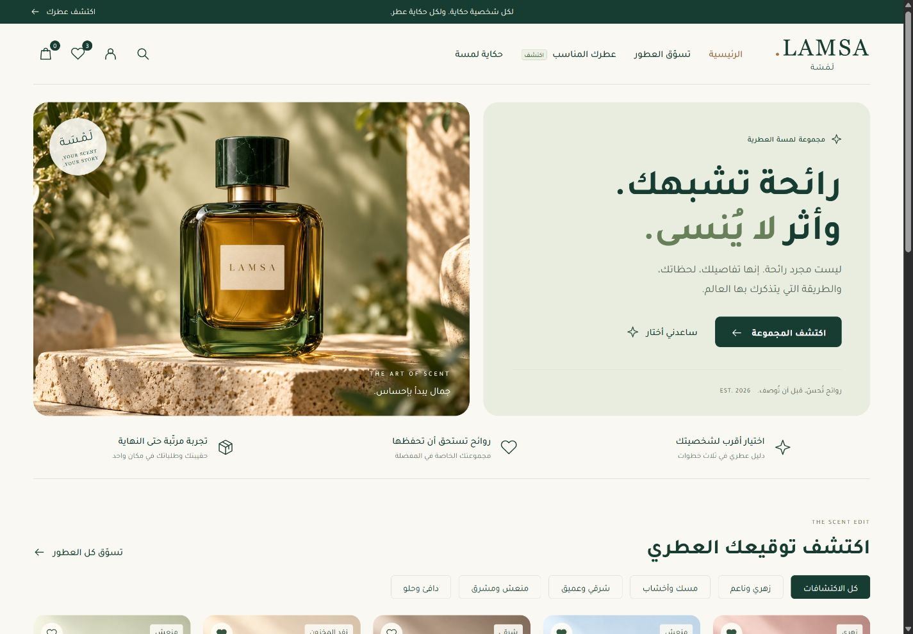

# LAMSA

[](https://github.com/mohiyaldeenCS/lamsa/actions/workflows/ci.yml)

A photographic, Arabic-first perfume storefront built with Flask, Jinja, and SQLite.

LAMSA combines a responsive right-to-left shopping experience with fragrance discovery, favorites, stock-aware checkout, and product and order administration. The catalog includes 35 illustrative fragrances across five scent families.



## Features

- Self-hosted Tajawal typography and six original illustrative perfume images.
- Catalog search, brand and fragrance-family filters, audience, bottle volume, price range, availability, sorting, and pagination.
- Product details, accessible quick-view dialogs, and a session-based wishlist.
- A three-question fragrance finder using catalog metadata and scent notes.
- Quantity-aware cart and local checkout with immutable order-item snapshots.
- Duplicate-submit protection and transactional stock checks.
- Customer order history and owner-only order access.
- Administrator product editing, image selection, inventory management, and order status transitions.
- Cancellation restores reserved inventory once.
- Hashed passwords, CSRF-protected forms, validated local redirects, and private session secrets.

**This is a local demonstration store.** Checkout records an order and adjusts inventory, but does not charge money, contact a carrier, or send notifications. The catalog and pictures are illustrative; several fragrances intentionally share imagery by scent family.

## Quick start

Python 3.11 or 3.13 is recommended.

```powershell
git clone https://github.com/mohiyaldeenCS/lamsa.git
cd lamsa
py -3.13 -m venv .venv
.\.venv\Scripts\Activate.ps1
python -m pip install -r perfume_project/requirements.txt
cd perfume_project
python init_db.py
python -m flask --app app:create_app create-admin
python -m flask --app app:create_app run
```

On macOS or Linux, create the environment with `python3 -m venv .venv` and activate it with `source .venv/bin/activate`.

Open [localhost:5000](http://127.0.0.1:5000). The administrator command prompts for a username and a password of at least 12 characters. No default accounts are created. Register a separate customer account through the interface to try the shopping flow.

For an existing installation, seeding adds missing sample products and preserves existing inventory, users, and orders. Schema upgrades are additive and back up an existing SQLite database before changing its structure.

## Configuration

- `SECRET_KEY`: optional environment secret. Without it, local development uses a private, persistent key in `perfume_project/instance/.secret_key`.
- `LAMSA_ADMIN_USERNAME` and `LAMSA_ADMIN_PASSWORD`: optional inputs to the explicit administrator-creation command. Interactive password entry is preferred.
- SQLite data lives in `perfume_project/instance/perfumes.db`.

Do not commit `instance/`, local environment files, database copies, or session keys. These are excluded by `.gitignore`. The Flask development server is intended for local use; payment, shipping, HTTPS hosting, mail, and operational monitoring are separate integrations.

## Tests

```powershell
cd perfume_project
python -m unittest discover -s tests -v
```

Tests use temporary SQLite databases, including concurrent purchases, transaction rollback, replayed checkout requests, CSRF, order ownership, catalog migrations, idempotent seeding, filters, and real rendered pages. GitHub Actions runs the suite on Python 3.11 and 3.13.

## Project layout

```text
app.py                        Root development launcher
perfume_project/
  app.py                      Application factory and routes
  catalog.py                  Catalog vocabulary, seeding, and CLI commands
  migrations.py               Additive schema upgrades
  models.py                   Accounts, products, orders, and order items
  forms.py                    Input validation
  data/catalog.json           Illustrative catalog
  templates/                  Arabic Jinja views
  static/                     Local typography, images, styles, and scripts
  tests/                      Isolated unit and integration tests
docs/                         Architecture, history, and operations
.github/                      CI and contribution templates
```

## Documentation

- [Architecture and data flow](docs/ARCHITECTURE.md)
- [Operations and backups](docs/OPERATIONS.md)
- [Repository history and branch conventions](docs/HISTORY.md)
- [Contributing](CONTRIBUTING.md)
- [Security reporting](SECURITY.md)
- [Changelog](CHANGELOG.md)
- [Release verification and limitations](docs/ENGINEERING-REVIEW.md)
- [Visual asset notes](perfume_project/static/images/ASSET-MANIFEST.md)

Maintained by [Mohiy Al-Deen](https://github.com/mohiyaldeenCS). The bundled Tajawal font retains its original [SIL Open Font License](perfume_project/static/fonts/OFL.txt).
